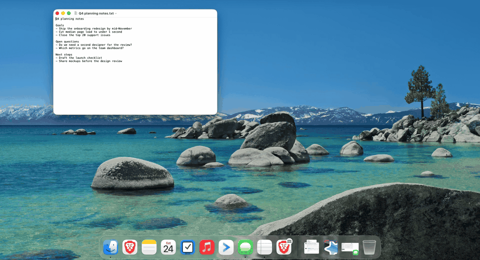

# Calendar Alarm

[](https://github.com/haydenholligan/calendar-alarm/actions/workflows/test.yml)

A full-screen, ringing alarm for your macOS Calendar events, with **no app running in the background**.



Calendar Alarm reads the calendars already synced into macOS Calendar (iCloud, Google, Exchange, local) and rings a full-screen alarm a few minutes before each event. The sound loops until you press **Dismiss**, **Snooze**, or **Join**.

Between checks nothing of Calendar Alarm stays in memory. There is no menu-bar icon, login item process, or helper. A LaunchAgent starts a short check once a minute. The check reads upcoming events and then exits. If an alarm is due before the next check, that same process waits, checks the event again, and rings.

## Why this exists

Calendar's own alerts are a notification banner and a single chime. If you're focused, in a full-screen app, or away from the desk for a minute, you miss the meeting.

The apps that fix this stay running all day, usually as a menu-bar app, to watch your calendar. That costs memory for every minute you aren't in a meeting. The only published figure we found was one developer's claim of "under 60 MB idle."

Calendar can also open a file or script when an event's alert fires, which needs no resident app. But you attach it to each event by hand, and it has historically worked only for "On My Mac" calendars, not iCloud or Google.

Calendar Alarm combines the two: every event on every calendar, rung loudly, with nothing left running between checks.

## What it focuses on

- **Nothing resident.** Each check is a fresh process that exits in a fraction of a second. Over a measured 24 hours of normal use on a MacBook Air, no Calendar Alarm process was running 98.3% of the time. Average memory was 0.22 MB, and each idle check took 38 ms of CPU and peaked at 4.3 MB. The hard limit for any process that stays around without ringing is 15 MB. Details in [`docs/feasibility.md`](docs/feasibility.md).
- **Hard to miss.** The alarm covers the screen, appears above full-screen apps and on every Space, and loops a sound until you press Dismiss, Snooze, or Join. If the screen is locked, the sound still plays. Keys are ignored for the first second, so a Return you were typing elsewhere can't dismiss it unseen. A compact window is available if full screen is too much.
- **Every calendar, automatically.** It reads what macOS Calendar already syncs: iCloud, Google, Exchange, and local calendars. There's no per-event setup and no separate sign-in. Moved, cancelled, and declined events are picked up at the next check.
- **Gets you into the meeting.** **Join** opens the event's Zoom, Google Meet, Teams, or Webex link directly, even when your company's mail security has wrapped it (Microsoft Safe Links, Proofpoint, Barracuda). Links are unwrapped on your Mac, with no network request.
- **Private.** No network access, analytics, or account. Saved state holds hashed keys and timestamps, never event details.
- **Recovers on its own.** If an alarm crashes before you respond, it rings once more. If the app is moved or rebuilt, opening it repairs the background agent.
- **Small and native.** Swift, AppKit, and EventKit, with no third-party dependencies. MIT licensed.
- **Honest about its limits.** It can't ring while the Mac is asleep, and it doesn't claim zero cost. See [Limitations](#limitations).

## Requirements

- macOS 14 or later. Tested so far only on macOS 26.5 (MacBook Air, Apple Silicon).
- Xcode 16 or later to build.
- An Apple Development (or Developer ID) signing identity in your keychain. Calendar permission is tied to the code signature, so ad-hoc builds lose access on every rebuild.

## Install from source

```sh
git clone https://github.com/haydenholligan/calendar-alarm
cd calendar-alarm
make install          # builds, signs and copies to /Applications
open "/Applications/Calendar Alarm.app"
```

In the window that opens:

1. **Grant Calendar Access…**, then **Allow**.
2. Tick **Ring alarms in the background**. If macOS asks, approve it under System Settings › General › Login Items.
3. **Test Background Alarm in 1 Minute**, then quit. The alarm should appear within a minute.

Calendar accounts must already be added in System Settings › Internet Accounts or in Calendar. Calendar Alarm never talks to iCloud, Google, or Microsoft directly, and never changes your events.

## Defaults

- All calendars, timed events only. All-day and declined events are skipped. Events can also be skipped by title in `config.json` (for example `"skipTitlesContaining": ["Lunch", "PTO"]`).
- One alarm 5 minutes before start. Multiple lead times can be set in `config.json` (for example `"leadMinutes": [5, 0]`).
- Snooze for 1, 5, or 10 minutes. **Join** appears for Zoom, Google Meet, Teams, and Webex links.
- Full-screen alarm. Untick **Cover the whole screen** in Settings for a compact floating window instead. Either way it stays above full-screen apps.
- If an alarm process crashes before you respond, the next check shows it once more, as long as it's still within the grace window.
- Alarms missed by more than 5 minutes (asleep, logged out) are skipped, not replayed.

Config: `~/Library/Application Support/com.corseapps.calendaralarm/config.json`. It holds `disabledCalendarIDs`, `leadMinutes`, `graceMinutes`, `skipAllDay`, `skipDeclined`, `skipTitlesContaining`, and `fullScreen`.

## Command line

```sh
app="/Applications/Calendar Alarm.app/Contents/MacOS/CalendarAlarm"
"$app" --status       # agent state, last check, next alarm, measured cost per check
"$app" --test-in 60   # ask the background check to ring a test alarm in 60 s
"$app" --ring-now "Design review" https://meet.google.com/abc-defg-hij   # preview the alarm window
"$app" --enable       # register the LaunchAgent (the settings window does this too)
"$app" --disable
```

`--status` shows what the last background check recorded. It doesn't query Calendar itself, because from Terminal macOS attributes Calendar access to the terminal app.

## Limitations

- **It can't ring while the Mac is asleep, shut down, or logged out.** After waking, alarms within the 5-minute grace window ring. Older ones are skipped.
- Events have to reach macOS Calendar first. Upstream sync delays from iCloud, Google, or Exchange are outside its control.
- If the screen is locked, the sound plays but the window only appears after you unlock. Muted output or missing speakers silence it; the window still shows.
- "Nothing in the background" means no Calendar Alarm process between checks. It does not mean zero cost. A check runs every minute; `--status` reports the measured CPU and memory per check.
- **If you move the app, or rebuild it ad-hoc, open it once.** The background agent stays registered to the old copy, and its checks fail until the app is opened. Settings detects this and re-registers the agent. Nothing can notice it without the app running.
- Not sandboxed and not on the App Store.

## Uninstall

Click **Uninstall…** in the settings window, or run:

```sh
make uninstall
```

Either way, this removes the LaunchAgent, the app, the saved state, and the Calendar permission. Your calendar events are never modified.

## Privacy

Event data stays on your Mac. There is no network access, no analytics, and no crash reporting. Saved state holds opaque hashed keys and timestamps only, never event titles, notes, or attendees.

## Development

```sh
make test   # swift test: planner, snooze, dedupe, link detection and unwrapping, storage
make app    # build and sign build/Calendar Alarm.app (universal; ARCHS=arm64 is faster)
```

See `docs/feasibility.md` for what was verified on real hardware and how.

## License

MIT
